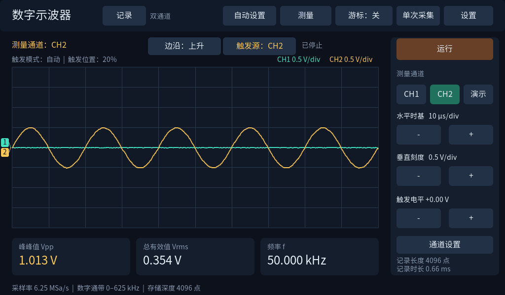

# 基于zynq7020的示波器

以 Zynq-7020 为核心的双通道数字示波器工程。PL 实现 ADC 采样、CIC 抽取、环形记录和硬件触发；PS 运行 FreeRTOS 与 LVGL，完成触屏界面、测量、频谱分析、TF 文件保存及恢复。项目已完成实板界面操作、TF 真断电留存和 QSPI 断电自动启动验证。

上图为板端显存导出的时域界面。硬件采用现成 Zynq-7020 开发板与双通道 ADC 模块，项目实现采集逻辑、嵌入式软件和触屏交互。

## 已验证的功能

- 双通道 10 bit、50 MSa/s 转换；每条记录 4096 个双通道 32 bit 打包字。
- 21 档时基（100 ns/div 至 500 ms/div）；原始 50 MSa/s，以及 CIC3 抽取后的 6.25 MSa/s、625 kSa/s、62.5 kSa/s、6.25 kSa/s、625 Sa/s。
- 独立触发源、上升/下降沿、约 20% 预触发；AUTO、NORMAL、单次冻结。
- Vpp、RMS、频率、游标、占空比、正负脉宽、10–90% 上升/下降时间及自动设置。超出有效条件的测量显示无效。
- 4096 点 FFT 快照，Hann/矩形窗、去均值、独立谱通道；显示使用原记录采样率。
- RAM 波形与参数暂存；TF 的 SCWv2 波形文件和 SCP1 参数文件保存、读取与手动恢复。
- QSPI 上电自动启动；正常使用无需电脑下载。参数文件需要手动恢复，RAM 槽掉电清空。

测量以专业信号源设定值作工程参考，未使用独立参考示波器或精密电压表。5 MHz 的结果为指定接线和输入条件下的幅频点测量；全工况模拟带宽、PVT 和温漂尚待验证。小信号幅度余差、幅度相关 DC 偏差和纹波问题详见 [验证范围](docs/verified-specs.md)。采集采用定长记录，不支持连续 50 MSa/s 存盘，采集死区尚未量化。

## 阅读与运行

- [构建说明](BUILD.md)：从干净目录运行 Windows 主机模拟器和 33 项 CTest；离线重建 ARM 应用、FSBL、BOOT 及硬件工程。
- [系统结构与代码导航](docs/architecture.md)
- [演示步骤](docs/demo.md)
- [验证范围和已知限制](docs/verified-specs.md)
- [第三方许可与原创代码声明](NOTICE.md)

`release/` 提供实板验证版本的 application.elf、platform.bit、storage.xsa、fsbl.elf 和 BOOT.bin 及 SHA256。`repro/` 保存对应的应用源码、BSP、官方 FSBL、PS 初始化与 BD 源。编译器、AMD/Xilinx IP、Windows SDK/系统库不随仓库分发，见构建说明。

`scripts/` 包含开发期测试和恢复脚本，部分脚本引用本地原始记录、历史版本或固定工具路径。构建请使用 `tools/build.py` 的参数化离线入口；使用板端下载、信号源控制和 Flash/SD 脚本前，需根据实际接线、设备身份和存储布局调整配置。
